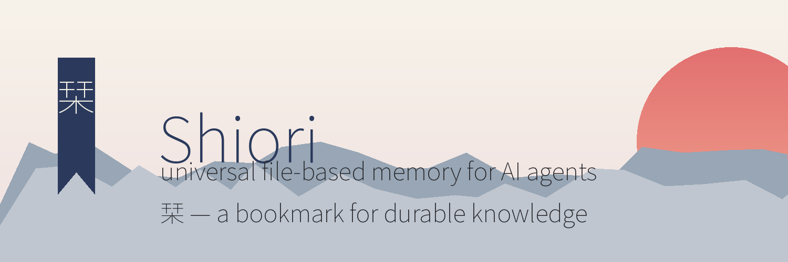

# Shiori — universal file-based memory for AI agents



A system scaffold for a **shared, versioned, encrypted knowledge base** used by
local AI agents (Hermes, opencode, and others). Named *Shiori* (栞, "bookmark"):
a universal index into durable knowledge, with no personal name attached.


## System vs. data

This repository contains **only the system**: docs, scripts, the optional markdown
reader, the opencode template, the upkeep skill, and the agent contract.

It does **not** contain knowledge data. The live bundle lives at `~/kb` (or any
path you choose) and is backed up separately with **Salt** to a private GitHub
repo. Salt handles encryption, filenames, signing, and the 12-word recovery
passphrase. Do not commit `~/kb` to this repository — the data route is Salt's.

## What Shiori is

- **KB** = Open Knowledge Format (OKF) v0.2 bundle: plain markdown + YAML
  frontmatter, navigated by `index.md` and relative links. No database, no
  embeddings, no runtime. `cat` reads it, `git clone` ships it.
- **Salt** = encrypts the bundle (and a safe copy of `state.db`) before it
  leaves the machine: filenames hidden, public-key signed, restore via 12-word
  passphrase. Daily cron seals + pushes to a private GitHub repo.
- **kbreader** = optional pure-Node markdown reader with a "Recent" view. It is
  not required: without it, the KB is just files on disk you write and read with
  any editor, and Salt still handles encrypted backup.
- **kb-upkeep** skill = event-driven capture of durable knowledge.
- **opencode integration** = ambient instructions only (file-based access; no MCP).

## Example usage

A knowledge page is just markdown with YAML frontmatter:

```markdown
---
type: Concept
title: Model routing
description: How agents pick provider/model aliases.
status: stable
stale_after: "2027-10-25T00:00:00Z"
generated: { by: "agent", at: "2026-10-25T00:00:00Z" }
sources: []
---

# Model routing

Explain how the agent selects a provider/model, and link to related pages.
```

Agents read it with ordinary file tools; humans can browse it in `kbreader`.

> The reader is optional — without it, the same page is just a file on disk.

## Commands

### For agents (install)

```bash
# 1. Create the data bundle (outside this repo)
mkdir -p ~/kb/concepts ~/kb/entities ~/kb/sources
cp AGENTS.md ~/kb/AGENTS.md
# edit ~/kb/index.md, then capture durable knowledge into concepts/entities/sources

# 2. Point an agent CLI at the contract (opencode template)
cp opencode/opencode.json ~/.config/opencode/opencode.json   # merge into yours
# Place the upkeep skill:
cp -r skills/kb-upkeep ~/.agents/skills/
```

### For humans (clone + run)

```bash
git clone https://github.com/ktypez/Shiori.git
cd Shiori

# Optional: browse the KB with the markdown reader
cd kbreader && pnpm install && ./start.sh   # http://localhost:8124
```

See [docs/install.md](docs/install.md) for Salt setup and daily backup.

## Quick start

See [docs/install.md](docs/install.md).

## Layout

```
scripts/     # salt-daily-backup.sh
kbreader/    # markdown reader (Node)
opencode/    # opencode.json template (instructions only)
skills/      # kb-upkeep skill (global ~/.agents/skills)
docs/        # install, usage, salt-backup
AGENTS.md    # contract for all agents
```

## Service vs. dev

- **Dev** = this repository (`~/projects/shiori` or a clone). Edit code, docs, templates, and
  skills here; commit and push.
- **Service** = the live locations on a machine (`~/kb`, `~/.config/opencode`,
  `~/.agents/skills`, `~/.hermes/scripts`). These are updated only by running
  `./deploy.sh` from a checkout — never by editing them in place and hoping the
  repo follows.
- `./deploy.sh` copies the system into `$SHIORI_SERVICE_ROOT`
  (default `~/.local/share/shiori`, no git) and then runs `install.sh`.

Keep the two separate: the repo ships the system, Salt ships the data, and
`install.sh` is the one-way bridge from dev to service.

The OKF bundle is created at `~/kb` during install (see docs/install.md). It is
kept out of this repository and backed up via Salt. See
[docs/salt-backup.md](docs/salt-backup.md).

## Credits

- **[Salt](https://github.com/spicy-lemonade/salt)** (MIT) — encrypted backup of
  the knowledge base and database memories before they leave the machine.
- **[OKF](https://github.com/scaccogatto/okf-skills)** — the Open Knowledge
  Format v0.2 bundle structure and validator.